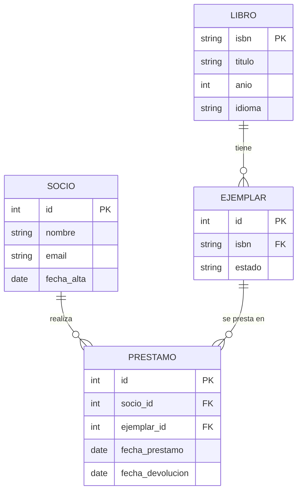
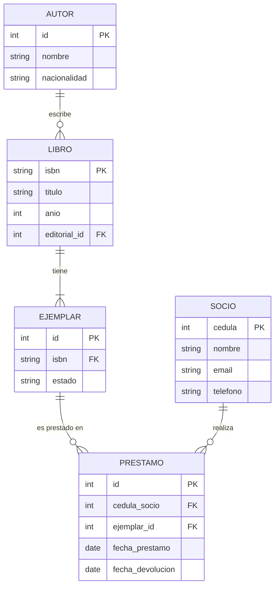
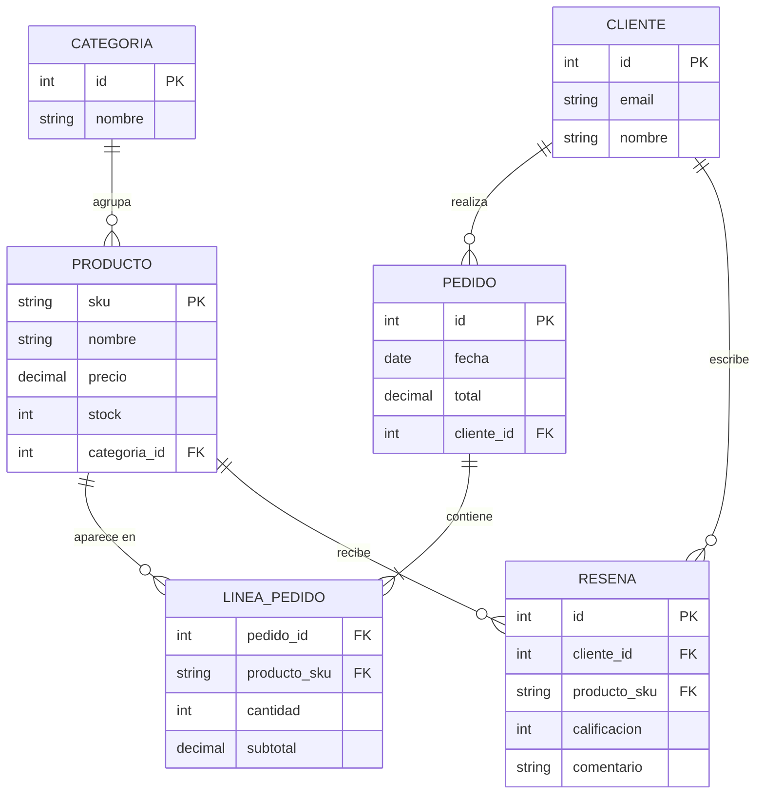
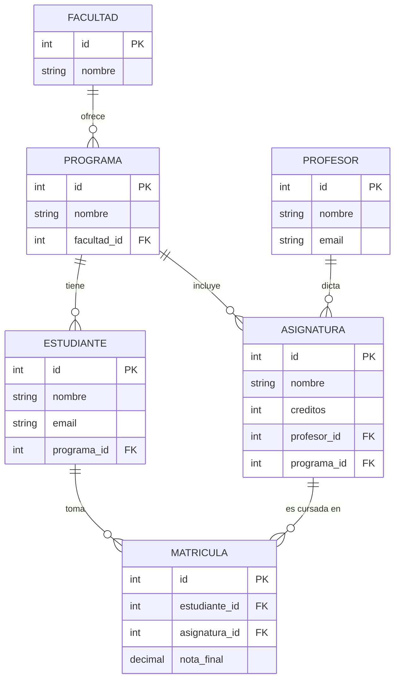

# Sesión 3 — Módulo 2 (parte 2): Diagramas Entidad-Relación

**Semana:** 3
**Corte:** 1
**Duración estimada:** 2 horas

---

## 1. Notaciones para diagramas ER

### Notación Chen (clásica)

```
   ( isbn )                    ( nombre )
       │                            │
       ▼                            ▼
   ┌────────┐    ┌────────┐    ┌────────┐
   │ Libro  │────│ escribe│────│ Autor  │
   └────────┘    └────────┘    └────────┘
   ○ título              N        ○ email
   ○ idioma              │        ○ fecha_nac
   ○ páginas             │ 1
                        ─┘
```

- Rectángulo = entidad.
- Óvalo = atributo.
- Rombo = relación.
- Subrayado = atributo clave.
- Doble óvalo = atributo multivalorado.
- Óvalo punteado = atributo derivado.

### Notación Pata de Cuervo (Crow's Foot, usada en UML)

```
   ┌────────┐                ┌────────┐
   │ Libro  │──────┐         │ Autor  │
   └────────┘      │         └────────┘
                   ▼
                  ╱╲
                 ╱  ╲
                ╱ N  ╲ M
                ╲    ╱
                 ╲  ╱
                  ╲╱
                  publica
```

- Rectángulo = entidad.
- Línea con símbolos = relación.
- `||` (dos líneas) = "uno y solo uno".
- `o|` = "cero o uno".
- `}|` = "muchos".

### Herramientas recomendadas

- **draw.io** (gratis, offline) — https://app.diagrams.net/
- **dbdiagram.io** (específico para BD) — https://dbdiagram.io/
- **Lucidchart** (online, freemium) — https://www.lucidchart.com/
- **Mermaid** (en Markdown) — integrado en GitHub.

---

## 2. Ejemplo con Mermaid (en Markdown)



---

## 3. Caso de estudio 1: Biblioteca

### Requerimientos

- La biblioteca tiene libros. De cada libro se conoce ISBN, título, autor(es), editorial, año.
- Cada libro puede tener varios ejemplares físicos.
- Hay socios que se identifican con cédula; tienen nombre, email y teléfono.
- Un socio puede tomar hasta 3 libros en préstamo.
- Un préstamo registra: socio, ejemplar, fecha de préstamo, fecha de devolución.

### Diagrama ER



---

## 4. Caso de estudio 2: Tienda Virtual

### Requerimientos

- La tienda vende productos clasificados por categorías.
- Cada producto tiene SKU, nombre, descripción, precio y stock.
- Los clientes se registran con email y contraseña; tienen nombre, dirección y teléfono.
- Los clientes pueden dejar reseñas (1-5 estrellas + comentario) sobre los productos.
- Un pedido pertenece a un cliente y contiene varios productos con cantidades.

### Diagrama ER (resumen)



---

## 5. Caso de estudio 3: Sistema Universitario

### Requerimientos

- La universidad tiene facultades, cada una con varios programas.
- Los estudiantes se matriculan en un programa y cursan asignaturas.
- Cada asignatura tiene un profesor, créditos y un semestre sugerido.
- Los estudiantes obtienen calificaciones por asignatura.
- Un profesor puede dictar varias asignaturas; una asignatura solo tiene un profesor por semestre.

### Diagrama ER (resumen)



---

## Ejercicios

### Ejercicio 1 — Biblioteca
A partir del caso de la biblioteca, dibuja el diagrama ER completo en `dbdiagram.io` o `draw.io` y exporta una imagen PNG.

### Ejercicio 2 — Tienda virtual
Haz lo mismo para la tienda virtual. **Detalle adicional:** agrega una entidad `Pago` con relación al `Pedido` (1:1), con atributos `monto`, `metodo` (tarjeta, PSE, efectivo) y `fecha_pago`.

### Ejercicio 3 — Sistema universitario
Dibuja el diagrama ER del sistema universitario. **Detalle adicional:** incluye una entidad `Horario` con `aula` y `bloque_horario` relacionada con `Asignatura`.

### Ejercicio 4 — Atributos completos
Para el sistema universitario, lista al menos:
- 3 atributos simples
- 1 atributo compuesto (con sus partes)
- 1 atributo multivalorado
- 1 atributo derivado
- 1 atributo opcional

### Ejercicio 5 — Caso libre
Modela el sistema de **gestión de un gimnasio** con al menos 5 entidades, incluyendo: socios, instructores, clases, pagos y reservas.

---

## Recursos

- https://dbdiagram.io/home
- https://mermaid.js.org/syntax/entityRelationshipDiagram.html
- Elmasri & Navathe — Capítulo 3.

---

**Próxima sesión:** Módulo 3 — Modelo Relacional (transformación ER → tablas).
