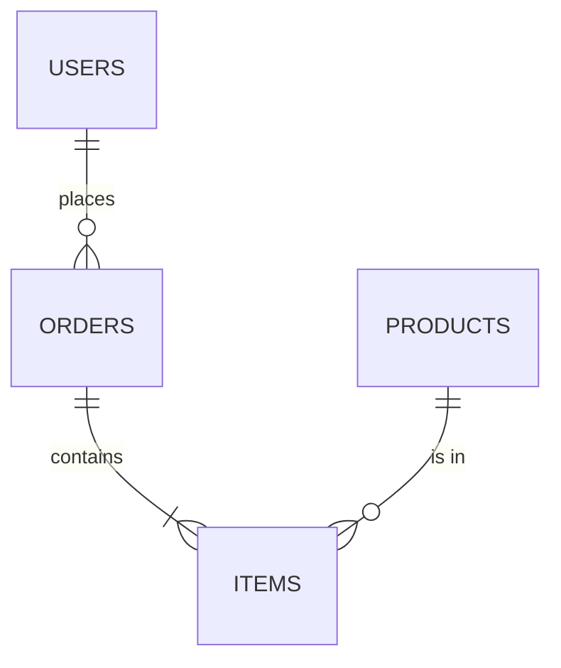

# Módulo 13: Base de Datos

## Objetivos de aprendizaje

Al finalizar este módulo, el estudiante será capaz de:

- Comprender el modelo relacional y el lenguaje SQL.
- Diseñar modelos entidad-relación normalizados.
- Crear relaciones entre tablas (1:1, 1:N, N:M).
- Aplicar índices y analizar consultas.
- Normalizar hasta la forma adecuada sin sobre-normalizar.
- Usar MySQL y PostgreSQL en la práctica.
- Manejar transacciones y consistencia.
- Aplicar migraciones y versionar el esquema.

---

## 1. SQL (Structured Query Language)

**SQL** es el lenguaje estándar para gestionar bases de datos relacionales. Se divide en sublenguajes:

- **DDL** (Data Definition Language): `CREATE`, `ALTER`, `DROP`, `TRUNCATE`.
- **DML** (Data Manipulation Language): `SELECT`, `INSERT`, `UPDATE`, `DELETE`.
- **DCL** (Data Control Language): `GRANT`, `REVOKE`.
- **TCL** (Transaction Control Language): `BEGIN`, `COMMIT`, `ROLLBACK`, `SAVEPOINT`.
- **DQL**: parte de DML centrada en `SELECT`.

### Bases de datos relacionales más usadas

- **PostgreSQL**: open source, rica en features, JSONB, extensiones.
- **MySQL / MariaDB**: muy populares en web.
- **SQLite**: embebida, ideal para apps pequeñas y móviles.
- **Oracle**, **SQL Server**, **DB2**: empresariales.

### Cliente universal

- **psql** (PostgreSQL), **mysql** (MySQL).
- **DBeaver**, **TablePlus**, **DataGrip**, **Beekeeper Studio**.

### Crear DB

```sql
-- PostgreSQL
CREATE DATABASE tienda;
\c tienda

-- MySQL
CREATE DATABASE tienda;
USE tienda;
```

### Tipos de datos comunes

| Tipo            | Descripción                             |
| --------------- | --------------------------------------- |
| `INTEGER`       | Entero                                  |
| `BIGINT`        | Entero grande                           |
| `SERIAL/IDENTITY` | Autoincremento                       |
| `DECIMAL(p, s)` | Numérico exacto                         |
| `FLOAT/DOUBLE`  | Punto flotante                          |
| `VARCHAR(n)`    | Texto variable                          |
| `CHAR(n)`       | Texto fijo                              |
| `TEXT`          | Texto largo                             |
| `BOOLEAN`       | Verdadero/Falso                         |
| `DATE`          | Fecha                                   |
| `TIME`          | Hora                                    |
| `TIMESTAMP`     | Fecha + hora                            |
| `JSON/JSONB`    | JSON nativo                             |
| `UUID`          | Identificador único universal           |
| `ENUM`          | Lista cerrada de valores                |

### `CREATE TABLE`

```sql
CREATE TABLE productos (
  id          SERIAL PRIMARY KEY,
  nombre      VARCHAR(120) NOT NULL,
  precio      DECIMAL(10, 2) NOT NULL CHECK (precio > 0),
  stock       INTEGER DEFAULT 0,
  categoria   VARCHAR(50),
  created_at  TIMESTAMP DEFAULT CURRENT_TIMESTAMP,
  updated_at  TIMESTAMP DEFAULT CURRENT_TIMESTAMP
);
```

### `INSERT`

```sql
INSERT INTO productos (nombre, precio, stock, categoria)
VALUES
  ('Laptop', 1200.00, 5, 'tecnologia'),
  ('Mouse', 25.00, 50, 'tecnologia'),
  ('Silla', 150.00, 10, 'hogar');

-- Insertar desde un SELECT
INSERT INTO productos_backup
SELECT * FROM productos WHERE categoria = 'tecnologia';
```

### `SELECT`

```sql
SELECT id, nombre, precio
FROM productos
WHERE precio BETWEEN 100 AND 1000
  AND categoria = 'tecnologia'
ORDER BY precio DESC
LIMIT 20 OFFSET 0;
```

### `UPDATE`

```sql
UPDATE productos
SET precio = precio * 0.9
WHERE categoria = 'hogar';
```

### `DELETE`

```sql
DELETE FROM productos WHERE stock = 0;
TRUNCATE productos;        -- vacía toda la tabla (DDL)
```

### `ALTER TABLE`

```sql
ALTER TABLE productos ADD COLUMN sku VARCHAR(20);
ALTER TABLE productos DROP COLUMN sku;
ALTER TABLE productos RENAME TO items;
ALTER TABLE productos ADD CONSTRAINT uq_sku UNIQUE (sku);
ALTER TABLE productos ALTER COLUMN precio SET NOT NULL;
```

### `DROP`

```sql
DROP TABLE productos;
DROP DATABASE tienda;
```

### Funciones agregadas

```sql
SELECT categoria, COUNT(*) AS cantidad, AVG(precio) AS media, MAX(precio) AS maximo
FROM productos
GROUP BY categoria
HAVING COUNT(*) > 1;
```

### Joins

```sql
SELECT u.nombre, p.titulo
FROM users u
LEFT JOIN posts p ON p.user_id = u.id
WHERE u.active = TRUE;
```

### Subconsultas

```sql
SELECT nombre, precio
FROM productos
WHERE precio > (SELECT AVG(precio) FROM productos);
```

### Common Table Expressions (CTE)

```sql
WITH top_cat AS (
  SELECT categoria, COUNT(*) AS total FROM productos GROUP BY categoria
)
SELECT * FROM top_cat WHERE total > 1;
```

Recursivo:

```sql
WITH RECURSIVE org AS (
  SELECT id, nombre, manager_id FROM employees WHERE manager_id IS NULL
  UNION ALL
  SELECT e.id, e.nombre, e.manager_id
  FROM employees e JOIN org o ON e.manager_id = o.id
)
SELECT * FROM org;
```

### Window Functions

```sql
SELECT
  nombre, categoria, precio,
  RANK() OVER (PARTITION BY categoria ORDER BY precio DESC) AS ranking
FROM productos;
```

### JSON (PostgreSQL)

```sql
SELECT data->>'email' AS email
FROM users
WHERE data->>'role' = 'admin';
```

### Vistas

```sql
CREATE VIEW v_productos_caros AS
SELECT nombre, precio FROM productos WHERE precio > 500;

DROP VIEW v_productos_caros;
```

### Actividad práctica

- Diseña 3 tablas (productos, categorías, ventas). Inserta datos y crea una vista con productos vendidos por mes.

---

## 2. Modelado de datos (Modelo Entidad-Relación)

### Conceptos

- **Entidad**: objeto del mundo real (Usuario, Producto, Pedido).
- **Atributo**: propiedad de la entidad.
- **Relación**: vínculo entre entidades.

### Diagrama ER

Herramientas:
- **dbdiagram.io** (DBAZ).
- **draw.io / diagrams.net**.
- **Mermaid** (texto).



### Tipos de entidad

- **Fuertes**: existencia propia (`USERS`).
- **Débiles**: dependen de otra (`ADDRESS` para `USER`).

### Cardinalidad

- **1:1**: `users ↔ profiles`.
- **1:N**: `users ↔ posts`.
- **N:M**: `posts ↔ tags` (con tabla intermedia).

### Pasos para modelar

1. Identificar entidades.
2. Identificar atributos y claves primarias.
3. Identificar relaciones.
4. Definir cardinalidades.
5. Normalizar.
6. Considerar desnormalización estratégica.

### Ejemplo: sistema de blog

```
users(id, name, email, password_hash, created_at)
posts(id, user_id, title, content, published, created_at)
comments(id, post_id, user_id, content, created_at)
tags(id, name)
post_tags(post_id, tag_id)
```

### Actividad práctica

- Modela un sistema de e-commerce: usuarios, productos, categorías, órdenes, ítems de orden, pagos, direcciones.

---

## 3. Relaciones

### 1:1

```sql
CREATE TABLE users (
  id   SERIAL PRIMARY KEY,
  email VARCHAR(120) UNIQUE NOT NULL
);

CREATE TABLE user_profiles (
  user_id INTEGER PRIMARY KEY REFERENCES users(id) ON DELETE CASCADE,
  bio     TEXT,
  avatar  VARCHAR(255)
);
```

### 1:N (Foreign Key)

```sql
CREATE TABLE posts (
  id        SERIAL PRIMARY KEY,
  user_id   INTEGER NOT NULL REFERENCES users(id) ON DELETE CASCADE,
  title     VARCHAR(200) NOT NULL,
  content   TEXT,
  created_at TIMESTAMP DEFAULT CURRENT_TIMESTAMP
);

CREATE INDEX idx_posts_user ON posts(user_id);
```

### N:M (tabla intermedia)

```sql
CREATE TABLE tags (
  id   SERIAL PRIMARY KEY,
  name VARCHAR(50) UNIQUE NOT NULL
);

CREATE TABLE post_tags (
  post_id INTEGER REFERENCES posts(id) ON DELETE CASCADE,
  tag_id  INTEGER REFERENCES tags(id)  ON DELETE CASCADE,
  PRIMARY KEY (post_id, tag_id)
);
```

### Acciones referenciales (`ON DELETE`/`ON UPDATE`)

- `CASCADE`: borra/actualiza en cascada.
- `SET NULL`: pone NULL.
- `SET DEFAULT`: valor por defecto.
- `RESTRICT`: rechaza la operación.
- `NO ACTION`: similar a RESTRICT.

### Self-references (auto-relación)

```sql
CREATE TABLE comments (
  id              SERIAL PRIMARY KEY,
  post_id         INTEGER REFERENCES posts(id) ON DELETE CASCADE,
  parent_comment_id INTEGER REFERENCES comments(id),
  content         TEXT NOT NULL
);
```

### Actividad práctica

- Crea el modelo completo de `posts`, `comments` (con respuestas anidadas) y `tags`.

---

## 4. Índices

Un índice es una estructura auxiliar que acelera búsquedas a costa de más espacio y costo en inserciones.

### Tipos

- **B-tree** (default): igualdad y rangos (`=`, `<`, `BETWEEN`, `ORDER BY`).
- **Hash**: solo igualdad en PostgreSQL `USING HASH`.
- **GIN**: full-text y JSONB (`@>`, `?`).
- **BRIN**: grandes tablas con datos ordenados (logs).
- **Composite**: múltiples columnas.

### Crear

```sql
-- Simple
CREATE INDEX idx_users_email ON users(email);

-- Único
CREATE UNIQUE INDEX uq_users_email ON users(email);

-- Compuesto
CREATE INDEX idx_orders_user_date ON orders(user_id, created_at DESC);

-- Parcial
CREATE INDEX idx_orders_pending ON orders(user_id)
  WHERE status = 'pending';

-- Funcional
CREATE INDEX idx_users_lower_email ON users(LOWER(email));
```

### Cuándo usar índices

- Columnas usadas en `WHERE`, `JOIN`, `ORDER BY`, `GROUP BY`.
- Foreign keys casi siempre.
- Campos únicos (email, username).
- Full-text con GIN o PG-specific FTS.

### Cuándo **NO**

- Tablas pequeñas.
- Columnas con muy poca cardinalidad (boolean, enum pequeño).
- Tablas con muchas escrituras (los índices penalizan INSERT/UPDATE).

### `EXPLAIN` / `EXPLAIN ANALYZE`

```sql
EXPLAIN SELECT * FROM users WHERE email = 'a@x.com';

EXPLAIN ANALYZE
SELECT p.* FROM posts p JOIN users u ON p.user_id = u.id
WHERE u.email = 'a@x.com';
```

Buscar:
- **Sequential Scan** (malo en tablas grandes).
- **Index Scan** (bueno).
- **Bitmap Index Scan** (apropiado para varias condiciones).
- **Nested Loop**, **Hash Join**, **Merge Join**.

### Mantenimiento

```sql
-- PostgreSQL
ANALYZE users;
VACUUM (ANALYZE) users;
REINDEX INDEX idx_users_email;

-- MySQL
ANALYZE TABLE users;
OPTIMIZE TABLE users;
```

### Actividad práctica

- Crea un índice sobre `users(email)`, ejecuta un `EXPLAIN ANALYZE` antes y después.

---

## 5. Normalización

Proceso de organizar tablas para **reducir redundancia** y **evitar anomalías de actualización**.

### Anomalías que evita

- **De inserción**: no poder guardar un dato sin otro.
- **De actualización**: cambiar un dato en muchos lugares.
- **De borrado**: perder información al borrar filas.

### Formas normales

#### 1FN (Primera Forma Normal)

- Valores **atómicos** (no listas ni conjuntos en una celda).
- Cada fila es única (PK).
- Sin columnas repetidas.

```sql
❌
CREATE TABLE orders_bad (
  id SERIAL PRIMARY KEY,
  productos VARCHAR(200)  -- "lap, mouse, teclado"
);

✅
CREATE TABLE orders (id SERIAL PRIMARY KEY);
CREATE TABLE order_items (order_id INT, product_id INT, qty INT);
```

#### 2FN

- Cumple 1FN.
- Todos los atributos no clave **dependen de la PK completa** (no de parte).
- Aplica a PK compuestas.

```sql
❌ order_items(order_id, product_id, product_name, qty)  -- product_name depende solo de product_id
✅ separar product_name en tabla products
```

#### 3FN

- Cumple 2FN.
- No hay **dependencias transitivas** (atributo no clave depende de otro atributo no clave).

```sql
❌ users(id, city_id, city_name)  -- city_name depende de city_id, no directamente de id
✅ cities(id, name), users(id, city_id FK)
```

#### BCNF (Boyce-Codd)

- Para toda dependencia X→Y, X debe ser superclave.
- Versión estricta de 3FN.

#### 4FN

- No hay dependencias multivaluadas.

#### 5FN / DKNF

- Elimina anomalías por joins.

### Cuándo **desnormalizar**

- Reportes/BI: joins costosos → columnas calculadas.
- Lecturas muy superiores a escrituras.
- Caché a nivel de fila (`last_login_at`, `comment_count`).

### Ejemplo completo

```sql
CREATE TABLE countries (
  id   SERIAL PRIMARY KEY,
  name VARCHAR(80) UNIQUE NOT NULL
);

CREATE TABLE cities (
  id          SERIAL PRIMARY KEY,
  country_id  INTEGER NOT NULL REFERENCES countries(id),
  name        VARCHAR(80) NOT NULL,
  UNIQUE (country_id, name)
);

CREATE TABLE users (
  id        SERIAL PRIMARY KEY,
  email     VARCHAR(120) UNIQUE NOT NULL,
  city_id   INTEGER REFERENCES cities(id),
  active    BOOLEAN DEFAULT TRUE,
  created_at TIMESTAMP DEFAULT CURRENT_TIMESTAMP
);
```

### Actividad práctica

- Toma un diseño no normalizado y llévalo a 3FN explicando cada paso.

---

## 6. MySQL

MySQL es una de las bases de datos más usadas, especialmente en stacks LAMP/LEMP.

### Características

- Motores: **InnoDB** (default, ACID, FK), **MyISAM** (legacy).
- Replicación, particionamiento, JSON nativo.
- Su sintaxis tiene pequeñas diferencias con PostgreSQL.

### Autoincremento

```sql
CREATE TABLE users (
  id   INT PRIMARY KEY AUTO_INCREMENT,
  email VARCHAR(120) UNIQUE NOT NULL,
  created_at TIMESTAMP DEFAULT CURRENT_TIMESTAMP
);
```

### Tipos importantes

- `TINYINT`, `SMALLINT`, `MEDIUMINT`, `INT`, `BIGINT`.
- `FLOAT`, `DOUBLE`, `DECIMAL`.
- `DATETIME`, `TIMESTAMP`, `DATE`, `TIME`, `YEAR`.
- `ENUM`, `SET`.
- `JSON`.

### ON DUPLICATE KEY / UPSERT

```sql
INSERT INTO users (email) VALUES ('a@x.com')
ON DUPLICATE KEY UPDATE active = TRUE;
```

```sql
INSERT INTO stats (user_id, hits) VALUES (1, 1)
ON DUPLICATE KEY UPDATE hits = hits + 1;
```

### Conexión Node.js

```bash
npm install mysql2
```

```js
import mysql from "mysql2/promise";

const conn = await mysql.createConnection({
  host: "localhost",
  user: "root",
  password: "secret",
  database: "tienda",
});

const [rows] = await conn.query("SELECT * FROM productos WHERE id = ?", [1]);
console.log(rows);
```

### `mysql2/promise` pool

```js
const pool = mysql.createPool({
  host: "localhost",
  user: "root",
  password: "secret",
  database: "tienda",
  waitForConnections: true,
  connectionLimit: 10,
});

const [rows] = await pool.query("SELECT 1");
```

### Características distintivas

- `INSERT IGNORE` (ignora errores por duplicados).
- Sin `RETURNING` (usar `LAST_INSERT_ID()`).
- `GROUP_CONCAT`.
- Sin JSONB indexado por defecto (usa índices en `JSON_EXTRACT`).

### Actividad práctica

- Crea una base de datos en MySQL con `mysql2`, inserta datos y consulta usando `?` placeholders.

---

## 7. PostgreSQL

PostgreSQL es la base de datos open source más avanzada.

### Características

- ACID completo, MVCC.
- JSON / JSONB indexable.
- CTEs, Window Functions, recursive queries.
- Extensiones (`pgcrypto`, `PostGIS`, `uuid-ossp`).
- Tipos customizados, ENUM, ARRAY.
- Full-text search nativo.

### Tipos especiales

- `JSONB` (binario, indexable con GIN).
- `UUID` con extensión.
- `INET` para IPs.
- `RANGE` (`int4range`, `tsrange`).
- `ARRAY`.

### Ejemplo con JSONB

```sql
CREATE TABLE logs (
  id  SERIAL PRIMARY KEY,
  meta JSONB
);

CREATE INDEX idx_logs_meta ON logs USING GIN (meta);

INSERT INTO logs (meta) VALUES ('{"user": 1, "action": "login"}');

SELECT * FROM logs WHERE meta @> '{"action": "login"}';
```

### `RETURNING`

```sql
INSERT INTO users (email) VALUES ('a@x.com')
RETURNING id, created_at;
```

```sql
UPDATE users SET active = TRUE
WHERE id = 1
RETURNING email, active;
```

### `UPSERT` (`ON CONFLICT`)

```sql
INSERT INTO users (email)
VALUES ('a@x.com')
ON CONFLICT (email) DO UPDATE SET active = EXCLUDED.active;
```

### Common Table Expressions

```sql
WITH q AS (
  SELECT categoria, AVG(precio) AS media
  FROM productos GROUP BY categoria
)
SELECT * FROM q WHERE media > 100;
```

### CTE recursivo (jerarquías)

```sql
WITH RECURSIVE tree AS (
  SELECT id, name, parent_id FROM categories WHERE parent_id IS NULL
  UNION ALL
  SELECT c.id, c.name, c.parent_id
  FROM categories c JOIN tree t ON c.parent_id = t.id
)
SELECT * FROM tree;
```

### Conexión Node.js

```bash
npm install pg
```

```js
import pg from "pg";
const { Pool } = pg;

export const pool = new Pool({
  host: "localhost",
  user: "postgres",
  password: "secret",
  database: "tienda",
  port: 5432,
});

await pool.query("SELECT NOW()");
```

Con ORM (Sequelize o Prisma) se abstrae.

### Roles y permisos

```sql
CREATE ROLE app_user LOGIN PASSWORD 'secret';
GRANT CONNECT ON DATABASE tienda TO app_user;
GRANT USAGE ON SCHEMA public TO app_user;
GRANT SELECT, INSERT, UPDATE, DELETE ON ALL TABLES IN SCHEMA public TO app_user;
```

### Actividad práctica

- Crea una tabla con JSONB, inserta datos y búscalos con `@>`. Compara con una query relacional.

---

## 8. Transacciones

Una **transacción** es una unidad de trabajo que se ejecuta **atómicamente** (`ACID`).

### ACID

- **Atomicity**: todo o nada.
- **Consistency**: la base pasa de un estado válido a otro.
- **Isolation**: las transacciones concurrentes no se interfieren.
- **Durability**: lo confirmado persiste.

### Estados de una transacción

```
BEGIN → modifica → COMMIT (ok) o ROLLBACK (error)
```

### Sintaxis

```sql
BEGIN;
UPDATE cuentas SET saldo = saldo - 100 WHERE id = 1;
UPDATE cuentas SET saldo = saldo + 100 WHERE id = 2;
COMMIT;
```

Si algo falla:

```sql
BEGIN;
UPDATE cuentas SET saldo = saldo - 100 WHERE id = 1;
-- error
ROLLBACK;
```

### `SAVEPOINT`

```sql
BEGIN;
INSERT INTO logs (msg) VALUES ('inicio');
SAVEPOINT sp1;
INSERT INTO users (email) VALUES ('a@x.com');
ROLLBACK TO sp1;
INSERT INTO users (email) VALUES ('b@x.com');
COMMIT;
```

### Niveles de aislamiento

| Nivel                       | Lectura sucia | No repetible | Phantom |
| --------------------------- | ------------- | ------------ | ------- |
| READ UNCOMMITTED            | sí            | sí           | sí      |
| READ COMMITTED (default PG) | no            | sí           | sí      |
| REPEATABLE READ (MySQL)     | no            | no           | sí      |
| SERIALIZABLE                | no            | no           | no      |

```sql
SET TRANSACTION ISOLATION LEVEL SERIALIZABLE;
```

### Deadlocks

Dos transacciones se bloquean mutuamente. La BD aborta una para resolver.

Mitigación:
- Orden consistente de locks.
- Transacciones cortas.
- `SELECT FOR UPDATE` ordenado.

### `SELECT ... FOR UPDATE`

Bloquea filas seleccionadas hasta el commit.

```sql
BEGIN;
SELECT stock FROM productos WHERE id = 1 FOR UPDATE;
UPDATE productos SET stock = stock - 1 WHERE id = 1;
COMMIT;
```

### En Node.js (pg)

```js
const client = await pool.connect();
try {
  await client.query("BEGIN");
  await client.query("UPDATE cuentas SET saldo = saldo - 100 WHERE id = 1");
  await client.query("UPDATE cuentas SET saldo = saldo + 100 WHERE id = 2");
  await client.query("COMMIT");
} catch (e) {
  await client.query("ROLLBACK");
  throw e;
} finally {
  client.release();
}
```

### Con Sequelize

```js
await sequelize.transaction(async (t) => {
  const from = await Account.findByPk(1, { transaction: t, lock: t.LOCK.UPDATE });
  from.balance -= 100;
  await from.save({ transaction: t });

  const to = await Account.findByPk(2, { transaction: t, lock: t.LOCK.UPDATE });
  to.balance += 100;
  await to.save({ transaction: t });
});
```

### Actividad práctica

- Implementa una transferencia bancaria entre dos cuentas con transacción.

---

## 9. Migraciones

Las **migraciones** son archivos versionados que modifican el esquema de la base de datos de manera reproducible.

### ¿Por qué?

- Cambios reproducibles entre entornos (dev, staging, prod).
- Historial de quién cambió qué.
- Rollbacks posibles.
- Coordinación entre desarrolladores.

### Herramientas

- **Sequelize CLI**.
- **Prisma Migrate**.
- **Knex migrations**.
- **Flyway**, **Liquibase** (Java world).
- **`dbmate`** (agnóstico).

### Sequelize CLI

```bash
npx sequelize-cli init
npx sequelize-cli model:generate --name User --attributes email:string,passwordHash:string
npx sequelize-cli db:migrate
npx sequelize-cli db:migrate:undo     # deshace la última
npx sequelize-cli db:migrate:undo:all
npx sequelize-cli db:seed:all
```

### Estructura

```
migrations/
  20250101000001-create-users.js
  20250102000001-add-role-to-users.js
seeders/
  20250101000000-demo-users.js
```

### Ejemplo de migración

```js
// migrations/20250101-create-products.js
export async function up(queryInterface, Sequelize) {
  await queryInterface.createTable("Products", {
    id: { type: Sequelize.INTEGER, autoIncrement: true, primaryKey: true },
    nombre: { type: Sequelize.STRING, allowNull: false },
    precio: { type: Sequelize.DECIMAL, allowNull: false },
    stock:  { type: Sequelize.INTEGER, defaultValue: 0 },
    createdAt: { type: Sequelize.DATE, allowNull: false },
    updatedAt: { type: Sequelize.DATE, allowNull: false },
  });
}

export async function down(queryInterface, Sequelize) {
  await queryInterface.dropTable("Products");
}
```

### Prisma Migrate

`prisma/schema.prisma` define el esquema y:

```bash
npx prisma migrate dev --name init
npx prisma migrate deploy     # producción
npx prisma migrate reset      # ⚠️ borra todo
```

Archivo generado automáticamente:

```
prisma/
  migrations/
    20250101000000_init/
      migration.sql
```

### Migraciones con SQL puro

```sql
-- migrations/001_init.sql
CREATE TABLE products ( ... );
CREATE TABLE tags ( ... );
```

```bash
psql -U user -d db -f migrations/001_init.sql
```

### Buenas prácticas

- **Commitea las migraciones** al repo.
- **Una migración por cambio lógico** (no mezcles cambios no relacionados).
- **Reversibles**: define el `down` siempre que sea posible.
- **Backups antes de migrar en producción**.
- **No edites migraciones ya aplicadas**: crea una nueva.
- Datos sensibles: **nunca** en migraciones, usar seeders.

### Seeders

```js
// seeders/20250101000000-demo-products.js
export async function up(queryInterface) {
  await queryInterface.bulkInsert("Products", [
    { nombre: "Laptop", precio: 1200, stock: 5, createdAt: new Date(), updatedAt: new Date() },
    { nombre: "Mouse",  precio: 25,   stock: 50, createdAt: new Date(), updatedAt: new Date() },
  ]);
}

export async function down(queryInterface) {
  await queryInterface.bulkDelete("Products", null, {});
}
```

### Actividad práctica

- Crea 2 migraciones: una inicial (products) y otra que añada `categoria`. Implementa el rollback.

---

## Buenas prácticas generales

### Naming

- **Tablas en plural y snake_case**: `users`, `order_items`.
- **PK**: `id`.
- **FK**: `user_id`, `order_id`.
- **Timestamps**: `created_at`, `updated_at`.

### Tipos consistentes

- Usa `UUID` si tu sistema es distribuido.
- Usa `DECIMAL` para dinero (nunca `FLOAT`).
- `TIMESTAMPTZ` (PostgreSQL) para zonas horarias.
- Define `BOOLEAN` explícitamente, no `TINYINT(1)`.

### Performance

- Pool de conexiones.
- Limita `SELECT *`.
- Usa `EXPLAIN` para queries críticas.
- Caching con Redis si aplica.
- Mantén estadísticas actualizadas (`ANALYZE`).

### Seguridad

- **No concatenar inputs** en SQL (usar prepared statements).
- Principio de **mínimo privilegio**: cada rol solo lo necesario.
- Conexiones cifradas (TLS).
- Backups automáticos y probados.

---

## Recursos complementarios

### Lecturas

- [PostgreSQL Docs](https://www.postgresql.org/docs/)
- [MySQL Docs](https://dev.mysql.com/doc/)
- [Use The Index, Luke!](https://use-the-index-luke.com/) (indexación)
- [Database Design for Mere Mortals](https://www.informit.com/store/database-design-for-mere-mortals-9780321884497)
- [SQL Antipatterns (Karwin)](https://pragprog.com/titles/bksqla/sql-antipatterns/)

### Práctica

- [SQLBolt](https://sqlbolt.com/)
- [PostgreSQL Exercises](https://pgexercises.com/)
- [SQL Murder Mystery](https://mystery.knightlab.com/)
- [HackerRank SQL](https://www.hackerrank.com/domains/sql)

### Herramientas

- **DBeaver** (cliente universal).
- **TablePlus**, **Beekeeper**, **DataGrip**.
- **pgAdmin**, **DBeaver** para Postgres.
- **Sequel Ace** (macOS), **DBeaver**.
- **dbdiagram.io**, **drawsql.lu** (diagramas).

---

## Evaluación sugerida

1. **Diseño relacional (25%)**: modelo ER completo normalizado en 3FN.
2. **SQL (25%)**: consultas complejas (joins, CTEs, window functions).
3. **Optimización (20%)**: usar `EXPLAIN`, crear índices apropiados.
4. **Transacciones (15%)**: operación atómica de transferencia.
5. **Migraciones (15%)**: 3 migraciones secuenciales con up/down.

---

> **Nota para el estudiante**: las bases de datos son el corazón de las aplicaciones. Antes de saltar a un ORM, **entiende SQL puro y el modelo relacional**. Te ahorrará horas de debugging cuando un ORM genere queries malas.
