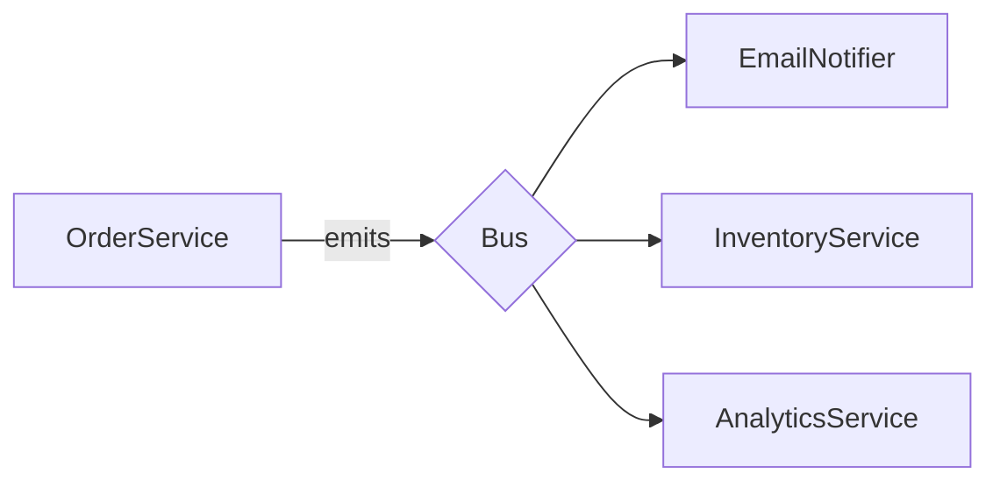

# Módulo 17: Arquitectura de Aplicaciones

## Objetivos de aprendizaje

Al finalizar este módulo, el estudiante será capaz de:

- Comprender los principios arquitectónicos clásicos y modernos.
- Aplicar MVC, arquitectura por capas y Clean Architecture.
- Usar los principios SOLID en el diseño.
- Modelar con Repository y Service Patterns.
- Construir DTOs para desacoplar capas.
- Aplicar Dependency Injection y comunicación basada en eventos.
- Conocer los fundamentos de CQRS.

---

## 1. MVC (Model View Controller)

Patrón clásico para UI: separar **datos (Model)**, **lógica de Controlador** y **presentación (View)**.

### Componentes

```
┌─────────┐
│  User   │
└────┬────┘
     ▼
┌─────────────┐
│  Controller │   orquesta flujo
└────┬────────┘
     ▼
┌─────────────┐
│   Model     │   datos + lógica de negocio
└─────────────┘
     ▲
     │
┌─────────────┐
│    View     │   renderiza
└─────────────┘
```

### Express como MVC

```js
// Model (Mongoose, Sequelize, Prisma, etc.)
const Task = mongoose.model("Task", { title: String, done: Boolean });

// Controller
exports.create = async (req, res) => {
  const task = await Task.create(req.body);
  res.status(201).json(task);
};

// View (HTML, JSON, etc.)
exports.list = async (req, res) => {
  res.render("tasks/list", { tasks: await Task.find() });
};
```

### MVC en frontend (React-like)

- **Model**: estado + datos.
- **View**: JSX/UI.
- **Controller**: handlers y stores.

### MVC en la práctica moderna

- MVC sigue siendo útil para **monolitos tradiciones**.
- En APIs REST, la **V** suele ser **JSON** (no hay vista real).
- Frameworks como Next.js (file-based routing), Django o Rails lo aplican.

### Ventajas

- Separación de responsabilidades.
- Onboarding más simple.
- Organización predecible.

### Limitaciones

- Acoplamiento Model ↔ DB.
- Lógica de negocio a veces termina en el controlador.
- Difícil de testear si todo conviven.

### Actividad práctica

- Refactoriza un endpoint monolítico a un modelo MVC simple.

---

## 2. Arquitectura por capas (Layered Architecture)

Organiza el código en **capas horizontales**, cada una con una responsabilidad concreta.

### Capas típicas (backend)

```
┌──────────────────────────────┐
│  Presentation (controllers)  │ ← HTTP, GraphQL, CLI
├──────────────────────────────┤
│  Application (services)      │ ← casos de uso
├──────────────────────────────┤
│  Domain (entities)           │ ← reglas de negocio puras
├──────────────────────────────┤
│  Infrastructure (repos, DB)  │ ← Sequelize, S3, mail
└──────────────────────────────┘
```

### Direccionalidad

Las dependencias apuntan **hacia adentro**: la presentación depende de la aplicación; la infraestructura implementa contratos del dominio.

### Implementación

```js
// routes/users.routes.js
import { Router } from "express";
import * as userCtrl from "../controllers/users.controller.js";

export const usersRouter = Router();
usersRouter.get("/",          userCtrl.list);
usersRouter.get("/:id",       userCtrl.getOne);
usersRouter.post("/",         userCtrl.create);
```

```js
// controllers/users.controller.js
import * as userService from "../services/users.service.js";

export async function list(req, res, next) {
  try {
    const data = await userService.listUsers(req.query);
    res.json(data);
  } catch (e) { next(e); }
}
```

```js
// services/users.service.js
import * as userRepo from "../repositories/users.repository.js";
import { CreateUserSchema } from "../schemas/user.js";

export async function listUsers({ page = 1, limit = 20, q = "" }) {
  return userRepo.findAll({ page, limit, q });
}

export async function createUser(input) {
  const data = CreateUserSchema.parse(input);
  return userRepo.create(data);
}
```

```js
// repositories/users.repository.js (Sequelize)
import { User } from "../models/index.js";

export async function findAll({ page, limit, q }) {
  const { count, rows } = await User.findAndCountAll({ ... });
  return { data: rows, total: count };
}

export async function create(data) {
  return User.create(data);
}
```

### Ventajas

- **Testabilidad**: capa de servicio sin Express, repositorio sin HTTP.
- **Sustituible**: cambiar Sequelize por Prisma afecta solo a `repositories/`.
- **Legible**.

### Riesgos

- Capas finas añadidas sin valor (anemic services).
- Sobre-ingeniería en CRUDs simples.

### Actividad práctica

- Crea una app mínima con `controllers/`, `services/`, `repositories/` y aislados con tests.

---

## 3. Clean Architecture

Propuesta por **Robert C. Martin (Uncle Bob)**. Las capas son **concentricas**: las dependencias apuntan **hacia el centro**.

### Capas

```
┌──────────────────────────────────────────────┐
│ Frameworks & Drivers (HTTP, DB, UI, externo) │
├──────────────────────────────────────────────┤
│ Interface Adapters (controllers, gateways)    │
├──────────────────────────────────────────────┤
│ Application (use cases)                       │
├──────────────────────────────────────────────┤
│ Enterprise Business Rules (entities)          │
└──────────────────────────────────────────────┘
```

Las **reglas de negocio puras** no saben de Express ni de Postgres.

### Implementación práctica

```
src/
├── domain/                (reglas puras)
│   ├── entities/
│   │   └── User.js
│   ├── repositories/      (interfaces)
│   │   └── UserRepository.js
│   └── use-cases/
│       ├── CreateUser.js
│       ├── GetUser.js
│       └── ListUsers.js
├── application/           (orquesta use-cases)
│   └── services/
│       └── UserService.js
├── infrastructure/        (implementaciones)
│   ├── db/sequelize/      (UserRepositoryImpl)
│   ├── http/express/      (controllers, routes)
│   └── config/
└── main.js
```

### Interfaces (puertos)

```js
// domain/repositories/UserRepository.js
export class UserRepository {
  async findById(id)      { throw new Error("not implemented"); }
  async findAll(opts)     { throw new Error("not implemented"); }
  async create(data)      { throw new Error("not implemented"); }
  async update(id, data)  { throw new Error("not implemented"); }
  async delete(id)        { throw new Error("not implemented"); }
}
```

### Implementación (adaptador)

```js
// infrastructure/db/sequelize/UserRepositorySequelize.js
import { UserRepository } from "../../../domain/repositories/UserRepository.js";
import { UserModel } from "../models/UserModel.js";

export class UserRepositorySequelize extends UserRepository {
  async findById(id) { return UserModel.findByPk(id); }
  async findAll({ limit, offset }) { return UserModel.findAll({ limit, offset }); }
  async create(data) { return UserModel.create(data); }
  // ...
}
```

### Use Case

```js
// domain/use-cases/CreateUser.js
import { CreateUserDTO } from "../dtos/CreateUserDTO.js";

export class CreateUser {
  constructor(userRepo, hasher) {
    this.userRepo = userRepo;
    this.hasher = hasher;
  }

  async execute(input) {
    const data = CreateUserDTO.from(input);
    const exists = await this.userRepo.findByEmail(data.email);
    if (exists) throw new Error("Email already registered");
    data.passwordHash = await this.hasher.hash(data.password);
    return this.userRepo.create(data);
  }
}
```

### Controller (entrada HTTP)

```js
// infrastructure/http/express/UserController.js
export function buildUserController({ createUser, listUsers }) {
  return {
    async create(req, res, next) {
      try {
        const user = await createUser.execute(req.body);
        res.status(201).json(user);
      } catch (e) { next(e); }
    },
  };
}
```

### Composition root

```js
// main.js
import { Sequelize } from "sequelize";
import { UserRepositorySequelize } from "./infrastructure/db/sequelize/UserRepositorySequelize.js";
import { CreateUser } from "./domain/use-cases/CreateUser.js";
import { UserController } from "./infrastructure/http/express/UserController.js";
import bcrypt from "bcrypt";

const sequelize = new Sequelize(process.env.DATABASE_URL);
const userRepo = new UserRepositorySequelize(sequelize);
const hasher = { hash: (p) => bcrypt.hash(p, 12) };

const createUser = new CreateUser(userRepo, hasher);
const userCtrl  = buildUserController({ createUser });

app.post("/users", userCtrl.create);
```

### Inversión de dependencias (DIP)

El dominio define **interfaces**; la infraestructura las implementa. El dominio no depende de infraestructura.

### Actividad práctica

- Implementa un "Create User" siguiendo Clean Architecture: dominio, use case, repo interface, repo sequelize, controller.

---

## 4. Principios SOLID

Aplicados a **diseño orientado a objetos** y arquitectura.

### S - Single Responsibility (SRP)

Una clase/módulo con **una sola razón para cambiar**.

```js
// ❌
class User {
  save() { /* db */ }
  sendWelcomeEmail() { /* mail */ }
  generateReport() { /* PDF */ }
}

// ✅
class User {}
class UserRepository { save() {} }
class MailService { sendWelcome() {} }
class ReportGenerator { from() {} }
```

### O - Open/Closed (OCP)

Abierto a extensión, cerrado a modificación.

```js
// ❌
function discount(type, price) {
  if (type === "regular") return price * 0.9;
  if (type === "vip")     return price * 0.8;
  if (type === "svip")    return price * 0.7;
}

// ✅
class Discount {
  calc(price) { return price; }
}
class RegularDiscount extends Discount { calc(p) { return p * 0.9; } }
class VIPDiscount     extends Discount { calc(p) { return p * 0.8; } }

function getDiscount(type) {
  const map = { regular: RegularDiscount, vip: VIPDiscount };
  return new (map[type] || Discount)();
}
```

### L - Liskov Substitution (LSP)

Las clases hijas deben poder **sustituir** a las padres.

```js
// ❌ Pato que no puede volar pero extiende Pajaro
class Bird { fly() {} }
class Penguin extends Bird {
  fly() { throw new Error("no fly"); } // rompe contrato
}

// ✅
class Bird {}
class FlyingBird extends Bird { fly() {} }
class Penguin extends Bird {}
```

### I - Interface Segregation (ISP)

Muchas interfaces específicas son mejores que una general.

```js
// ❌
class Worker {
  work() {}
  eat() {}
  sleep() {}
}

// ✅
class Workable { work() {} }
class Eatable { eat() {} }
```

### D - Dependency Inversion (DIP)

Depender de **abstracciones**, no de concreciones.

```js
// ❌
class OrderService {
  constructor() { this.db = new MySQLDatabase(); }
}

// ✅
class OrderService {
  constructor(db) { this.db = db; }  // db: cualquier implementación
}

const orderService = new OrderService(new MySQLDatabase());
const orderService2 = new OrderService(new MockDatabase()); // tests
```

### Aplicación

- **SRP** en controladores (1 endpoint por función).
- **OCP** en handlers (decoradores, middlewares).
- **LSP** en jerarquías (Repository pattern).
- **ISP** en services pequeños.
- **DIP** inyectando dependencias (composición, contenedores).

### Actividad práctica

- Toma una clase grande y divídela siguiendo SRP. Identifica una abstracción que debería existir (DIP).

---

## 5. Repository Pattern

Abstrae el **acceso a datos** detrás de una interfaz.

### Interfaz

```js
export class ProductRepository {
  async findAll(opts)  {}
  async findById(id)    {}
  async create(data)    {}
  async update(id, data){}
  async delete(id)      {}
}
```

### Implementaciones

```js
// sequelize
export class ProductRepositorySequelize extends ProductRepository {
  constructor(model) { this.model = model; }
  async findAll({ limit, offset }) { return this.model.findAll({ limit, offset }); }
  async findById(id)               { return this.model.findByPk(id); }
  // ...
}
```

```js
// in-memory (tests)
export class ProductRepositoryMemory extends ProductRepository {
  constructor() { this.items = []; }
  async create(data) {
    const item = { id: this.items.length + 1, ...data };
    this.items.push(item);
    return item;
  }
  // ...
}
```

### Uso

```js
// composition.js
const productRepo = process.env.NODE_ENV === "test"
  ? new ProductRepositoryMemory()
  : new ProductRepositorySequelize(ProductModel);

export { productRepo };
```

### Beneficios

- Tests sin DB.
- Migrar de ORM sin tocar la lógica.
- Cohesión: todo acceso a datos vive aquí.

### Actividad práctica

- Implementa repositorios para `users` con implementaciones en memoria y Sequelize, y usa ambos en tests/service.

---

## 6. Service Pattern

Contiene la **lógica de negocio** y los casos de uso.

```js
export class UserService {
  constructor(userRepo, hasher, mailer) {
    this.userRepo = userRepo;
    this.hasher   = hasher;
    this.mailer   = mailer;
  }

  async register(input) {
    const data = UserSchema.parse(input);
    if (await this.userRepo.findByEmail(data.email)) throw new ConflictError();
    const user = await this.userRepo.create({
      ...data,
      passwordHash: await this.hasher.hash(data.password),
    });
    await this.mailer.sendWelcome(user.email);
    return user;
  }
}
```

### Errores de dominio

```js
export class DomainError extends Error {
  constructor(message, code = "DOMAIN") {
    super(message);
    this.name = "DomainError";
    this.code = code;
  }
}

export class ValidationError extends DomainError {
  constructor(issues) { super("Validation failed", "VALIDATION"); this.issues = issues; }
}

export class ConflictError extends DomainError {
  constructor(msg = "Conflict") { super(msg, "CONFLICT"); }
}

export class NotFoundError extends DomainError {
  constructor(msg = "Not Found") { super(msg, "NOTFOUND"); }
}
```

### Controller delgado

```js
export async function register(req, res, next) {
  try {
    const user = await userService.register(req.body);
    res.status(201).json(publicUser(user));
  } catch (e) { next(e); }
}
```

### Middleware de errores (mapeo)

```js
export function errorMiddleware(err, req, res, next) {
  if (err instanceof ValidationError) return res.status(400).json({ error: err.code, issues: err.issues });
  if (err instanceof NotFoundError)   return res.status(404).json({ error: err.code });
  if (err instanceof ConflictError)   return res.status(409).json({ error: err.code });
  console.error(err);
  res.status(500).json({ error: "Internal" });
}
```

### Actividad práctica

- Crea un `OrderService` con `placeOrder`, `cancelOrder` y errores de dominio propios.

---

## 7. DTO (Data Transfer Object)

Objeto simple usado para **transferir datos** entre capas. Evita exponer entidades de DB y aísla contratos públicos.

### Implementación simple

```js
// dtos/UserDTO.js
export class UserDTO {
  static from(user) {
    return {
      id: user.id,
      email: user.email,
      name: user.name,
      role: user.role,
      createdAt: user.createdAt,
    };
  }
}
```

### DTO por caso de uso

```js
export class CreateUserDTO {
  static from(input) {
    return UserSchema.parse(input);
  }
}

export class UpdateUserDTO {
  static from(input) {
    return UserSchema.partial().parse(input);
  }
}
```

### Mapeo bidireccional

```js
class UserDTO {
  toPublic() { return { id: this.id, email: this.email }; }
  fromInput(input) { Object.assign(this, input); }
}
```

### Cuándo usar

- APIs públicas (no exponer campos sensibles).
- Comandos que vienen del cliente.
- Mensajes en event bus (entre servicios).

### Evitar DTOs para todo

- CRUDs simples pueden no necesitarlos.
- Sobre-mapeo introduce complejidad innecesaria.

### Actividad práctica

- Define DTOs `PublicUserDTO`, `CreateUserDTO`, `UpdateUserDTO` y aplícalos en el service y controller.

---

## 8. Dependency Injection

Patrón que **provee las dependencias** a una clase en lugar de que esta las cree.

### Tipos

- **Constructor** (preferido).
- **Setter** (raro).
- **Property** (poco usado).
- **Container** (frameworks).

### Constructor

```js
class OrderService {
  constructor(orderRepo, paymentGateway, mailer) {
    this.orderRepo = orderRepo;
    this.paymentGateway = paymentGateway;
    this.mailer = mailer;
  }
}

const orderService = new OrderService(orderRepo, stripe, mailer);
```

### Composition root

```js
// src/container.js
import { PrismaUserRepository } from "./infra/PrismaUserRepository.js";
import { BcryptHasher } from "./infra/BcryptHasher.js";
import { SmtpMailer } from "./infra/SmtpMailer.js";
import { UserService } from "./domain/UserService.js";

export function createContainer() {
  const userRepo = new PrismaUserRepository(prisma);
  const hasher   = new BcryptHasher();
  const mailer   = new SmtpMailer();

  return {
    userService: new UserService(userRepo, hasher, mailer),
  };
}
```

```js
// server.js
const { userService } = createContainer();
app.use("/api/users", buildUserRoutes({ userService }));
```

### Containers (TypeScript)

```ts
import { container } from "tsyringe";

container.register("IUserRepository", { useClass: PrismaUserRepository });

class UserService {
  constructor(@inject("IUserRepository") private repo: IUserRepository) {}
}
```

Otros:
- `awilix` (líder en JS).
- `inversify`.

### Beneficios

- **Testabilidad**: sustituir dependencias por dobles.
- **Flexibilidad**: cambiar implementaciones sin tocar lógica.
- **Cohesión**: composición centralizada.

### Errores comunes

- **Service Locator** (`MyService.findDep()`). Se "buscan" dependencias en runtime → dificulta testing y refactor.
- Acoplar a **tipos concretos** (sin interfaz).
- Demasiados parámetros (5+).

### Actividad práctica

- Refactoriza un service con `new X()` interno al patrón constructor + composition root.

---

## 9. Eventos (comunicación basada en eventos)

Permiten **baja cohesión**: un emisor publica hechos y varios suscriptores reaccionan.

### Bus en proceso (EventEmitter)

```js
import { EventEmitter } from "node:events";
export const bus = new EventEmitter();

bus.on("user.registered", (user) => {
  console.log("Send welcome email:", user.email);
});

await userService.register(input);
bus.emit("user.registered", user);
```

### Event bus desacoplado

```js
// lib/bus.js
export const bus = {
  listeners: {},
  on(event, fn) { (this.listeners[event] ??= []).push(fn); },
  emit(event, ...args) { (this.listeners[event] ?? []).forEach(fn => fn(...args)); },
};
```

### Con async handlers

```js
bus.on("user.registered", async (user) => {
  await mailer.sendWelcome(user.email);
});
```

### Error handling

```js
bus.on("user.registered", async (user) => {
  try {
    await mailer.sendWelcome(user.email);
  } catch (err) {
    console.error("Email failed", err);
  }
});
```

```js
// Wrapper de bus
const safeOn = (event, fn) => bus.on(event, async (...args) => {
  try { await fn(...args); } catch (e) { console.error(e); }
});
```

### Outbox pattern (eventos persistentes)

Para garantizar entrega:

```sql
CREATE TABLE outbox (
  id           SERIAL PRIMARY KEY,
  topic        VARCHAR(100),
  payload      JSONB,
  processed_at TIMESTAMP,
  created_at   TIMESTAMP DEFAULT CURRENT_TIMESTAMP
);
```

```js
await db.transaction(async (t) => {
  const order = await orderRepo.create(input, { transaction: t });
  await outboxRepo.add({ topic: "order.created", payload: order }, { transaction: t });
});

// Worker
setInterval(async () => {
  const pending = await outboxRepo.findPending(20);
  for (const e of pending) {
    await publish(e);
    await outboxRepo.markProcessed(e.id);
  }
}, 1000);
```

### Event brokers (multi-proceso/multi-servicio)

- **Redis Pub/Sub**: simple.
- **RabbitMQ**, **Kafka**: garantía de entrega, particionado.
- **NATS**, **Pulsar**.
- **AWS EventBridge / SNS**, **Google Pub/Sub**.

```js
import { createClient } from "redis";
const redis = createClient();
await redis.connect();

const sub = redis.duplicate();
sub.subscribe("orders.created", (msg) => console.log("Order:", msg));

await redis.publish("orders.created", JSON.stringify({ id: 1 }));
```

### Event-driven architecture



### Actividad práctica

- Implementa un bus en proceso, crea 2 suscriptores al evento `order.placed` y verifica la independencia entre emisor y suscriptores.

---

## 10. CQRS (Command Query Responsibility Segregation)

Separa el modelo de **escritura (commands)** del de **lectura (queries)**.

### Concepto

```
                ┌──────────────────┐
   Commands ──▶ │ Command Side     │   writes
                │ (write model)    │
                └────────┬─────────┘
                         │ events
                         ▼
                ┌──────────────────┐
   Queries  ──▶ │ Query Side       │   reads
                │ (read model)     │
                └──────────────────┘
```

### ¿Por qué?

- Optimizar lectura y escritura por separado.
- Escalado independiente.
- Diferentes modelos según el caso de uso.
- Auditoría y trazabilidad claras.

### Ejemplo simple

```js
// Command
class CreateProductCommand {
  constructor({ name, price, userId }) {
    this.name = name; this.price = price; this.userId = userId;
  }
}

class CreateProductHandler {
  constructor(productRepo, eventBus) {
    this.repo = productRepo; this.bus = eventBus;
  }
  async execute(cmd) {
    const product = await this.repo.create(cmd);
    this.bus.emit("product.created", product);
    return product;
  }
}

// Query
class SearchProductsQuery {
  constructor({ term, page }) { this.term = term; this.page = page; }
}

class SearchProductsHandler {
  constructor(readDb) { this.readDb = readDb; }
  async execute(q) {
    return this.readDb.search(q.term, q.page);
  }
}
```

### Read Model desnormalizado

```js
// Suscripción al evento: actualiza índice de búsqueda
bus.on("product.created", async (product) => {
  await readDb.index.put({
    id: product.id,
    nameLower: product.name.toLowerCase(),
    description: product.description,
  });
});
```

### Cuándo tiene sentido

- **Consultas complejas** (búsqueda, análisis) que el modelo transaccional no cubre.
- **Alto desacople** entre lectura y escritura.
- **Eventual consistency** aceptable.

### Cuándo NO

- CRUDs simples donde una sola tabla o vista basta.
- Donde la consistencia estricta es necesaria.
- Equipos pequeños: añade complejidad.

### Combinado con Event Sourcing

Los **commands** producen **eventos** que son la fuente de verdad. Los **queries** se construyen proyectando esos eventos.

```js
// Event store
class EventStore {
  append(stream, event) { /* ... */ }
  getStream(streamId) { /* ... */ }
}

// Proyección (read model)
function buildSearchProjection(event) {
  if (event.type === "product.created") {
    return {
      op: "index",
      doc: event.payload,
    };
  }
}
```

### Herramientas

- **CQRS**: `nestjs/cqrs`, `ts-cqrs`.
- **Event Sourcing**: `eventstore`, `Marten`, `Axon`.
- **Read stores**: Elasticsearch, OpenSearch, Redis.

### Actividad práctica

- Separa un CRUD simple en commands + handlers y queries + handlers usando el patrón CQRS.

---

## Estilos arquitectónicos complementarios

### Hexagonal Architecture (Ports & Adapters)

Variante de Clean. El dominio define **puertos**, y la infraestructura provee **adaptadores**.

```
        Driver adapters
        ┌────────────┐
        │  HTTP API  │
        └─────┬──────┘
              ▼
       ┌─────────────┐
       │   Domain    │
       │   ports     │
       └─────┬───────┘
             ▼
        Driven adapters
        ┌────────────┐
        │   DB / MQ  │
        └────────────┘
```

### Microservicios

Cada servicio tiene su propia DB, su propio deploy, su responsabilidad.

```
Order Service    Catalog Service    Payment Service
        ↓              ↓                 ↓
   PostgreSQL       MongoDB           Postgres
```

### Cuando aplicarlos

| Tamaño / complejidad | Estilo            |
| -------------------- | ----------------- |
| CRUD simple          | Layered           |
| Lógica media         | Clean / Hexagonal |
| Lecturas pesadas     | CQRS              |
| Equipos independientes | Microservicios |

### Trade-offs

- **Capas**: simple, pero puede abstraer en exceso.
- **Clean**: potente, pero verbosa para CRUDs.
- **Microservicios**: escala, pero añade red, consistencia eventual, infra.

### Actividad práctica

- Dibuja diagramas (Mermaid, draw.io) de las arquitecturas propuestas para 3 proyectos diferentes.

---

## Métricas y calidad

### Cohesión y acoplamiento

- **Alta cohesión**: lo que cambia junto está junto.
- **Bajo acoplamiento**: dependencias mínimas y estables.

### Heurísticas

- Una capa no debe importar de otra "superior".
- `controllers/` no debería importar `db/`.
- `repositories/` no debería importar `express`.

### Tests por capa

- **Unit (dominio, use cases)**: rápidos, sin IO.
- **Integration (repositories)**: DB en memoria o containerizada.
- **E2E (controllers)**: app completa.

```js
test("create user hash password", async () => {
  const repo = new InMemoryUserRepository();
  const hasher = { hash: (p) => `hashed:${p}` };
  const svc = new UserService(repo, hasher);

  const u = await svc.register({ email: "a@x.com", password: "secret123" });

  expect(u.password).toBe("hashed:secret123");
});
```

### Actividad práctica

- Mide cobertura de tests de tu proyecto y apunta a 70%+ en domain/services.

---

## Recursos complementarios

### Lecturas

- [Clean Architecture - Robert C. Martin](https://blog.cleancoder.com/uncle-bob/2012/08/13/the-clean-architecture.html)
- [Hexagonal Architecture](https://alistair.cockburn.us/hexagonal-architecture/)
- [SOLID (original)](https://en.wikipedia.org/wiki/SOLID)
- [Martin Fowler - Patterns of Enterprise Application Architecture](https://martinfowler.com/books/eaa.html)
- [Mikhail Shilkov - CQRS](https://www.youtube.com/results?search_query=cqrs+explained)

### Librerías y frameworks

- **awilix** (DI container para Node).
- **tsyringe** (DI para TypeScript).
- **nestjs/cqrs** (CQRS + event sourcing style).
- **TypeORM**, **Sequelize**, **Prisma**.
- **EventStore**, **Marten** (.NET), **Kafka**.

---

## Evaluación sugerida

1. **Clean Architecture (30%)**: proyecto con dominio, use cases, repo interface e implementación concreta.
2. **Repository + Service + DTO (25%)**: capas bien definidas con al menos 2 repositorios y DTOs.
3. **Dependency Injection (20%)**: composition root y configuración testeable.
4. **Eventos (15%)**: bus in-process + 2 suscriptores + manejo de errores.
5. **CQRS (10%)**: separación commands/queries en una feature.

---

> **Nota para el estudiante**: arquitectura no es un "patrón único para todo proyecto". Es una **decisión por contexto**. Empieza con capas simples. Cuando duela, refactoriza. Y siempre, **primero entender el dominio**.
